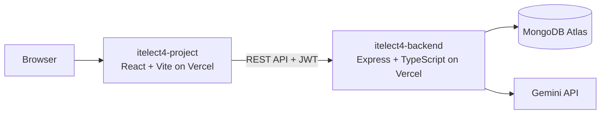

# ITELECT4 Project

[](https://github.com/angelomarasigan798-sys/itelect4-project/actions/workflows/ci.yml)

A React and TypeScript appointment-management app with authentication,
appointment scheduling, and an authenticated AI Review page.

- **Live frontend:** https://itelect4-project.vercel.app
- **Live backend:** https://itelect4-backend-nu.vercel.app
- **Backend health check:** https://itelect4-backend-nu.vercel.app/api/health
- **Backend repository:** https://github.com/angelomarasigan798-sys/itelect4-backend

## Architecture



## Run locally

Use Node.js 24 and npm. In one terminal, start the backend using the setup in
the [backend README](https://github.com/angelomarasigan798-sys/itelect4-backend#run-locally).
In this repository:

```powershell
npm ci
Copy-Item .env.example .env.local
npm run dev
```

Set `VITE_API_URL` in `.env.local` to the backend origin (for example,
`http://localhost:4000`). Do not put backend secrets in frontend variables.

## Checks

```powershell
npm test
npm run lint
npm run build
```

GitHub Actions runs lint, tests, and the production build on every push.

## AI-use disclosure

AI assistance was used to help implement and verify the tests, CI workflows,
and this documentation. The repository owner should review and be prepared to
explain every change before submission.
